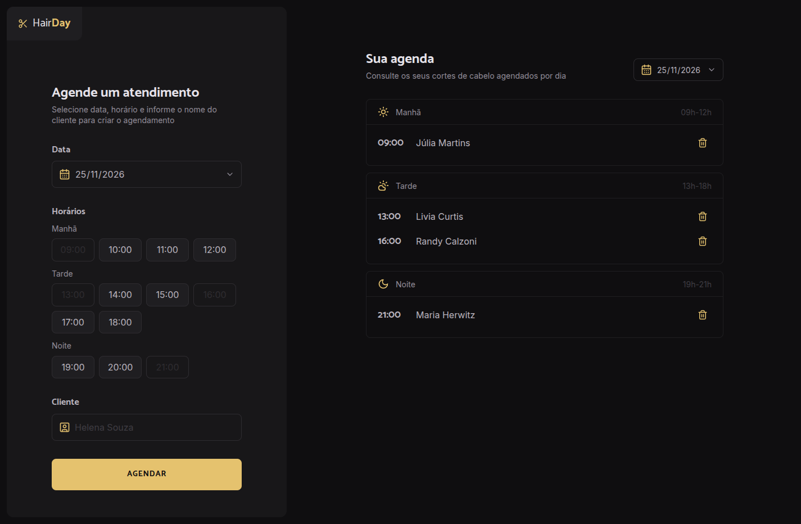
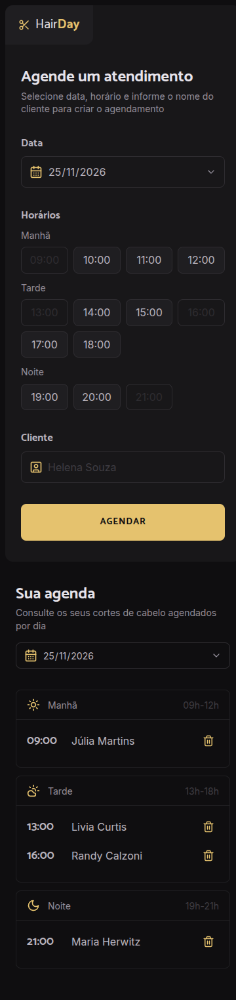

# HairDay ✂️

Aplicação web (SPA) para gerenciar agendamentos de um salão de beleza ou barbearia. Projeto 04 da disciplina **Single Page Application**, desenvolvido com React, TypeScript e apoio de agente de IA.



## Funcionalidades

- Cadastro de agendamento com **data**, **horário** e **nome do cliente**.
- Validação do formulário (campos obrigatórios, data/horário no passado, horário já ocupado, nome inválido).
- Horários ocupados ou que já passaram ficam desabilitados.
- Agenda filtrada pela data selecionada.
- Agendamentos agrupados em **Manhã (09h–12h)**, **Tarde (13h–18h)** e **Noite (19h–21h)**, em ordem crescente.
- Mensagem quando não há agendamentos no período.
- Exclusão pelo botão de lixeira, com atualização imediata.
- Persistência no `localStorage`.
- Layout responsivo (desktop e mobile).

## Tecnologias

- [React 19](https://react.dev) + [Vite](https://vite.dev)
- [TypeScript](https://www.typescriptlang.org) (strict)
- CSS puro com variáveis
- [lucide-react](https://lucide.dev) (ícones)

## Conceitos aplicados

| Conceito | Onde |
| --- | --- |
| `useState` | `AppointmentsContext.tsx` (lista e data filtrada), `ScheduleForm.tsx` (formulário e erros) |
| Context API + Provider | `src/context/AppointmentsContext.tsx` |
| Hooks customizados | `useAppointments`, `useDailySchedule` |
| Props | `PeriodSection`, `AppointmentItem`, `HourPicker`, `HourButton`, `DateInput`, `Field`... |
| `map()` | renderização de períodos, horários e agendamentos |
| `filter()` | agendamentos do dia e remoção |
| `reduce()` | agrupamento por período em `useDailySchedule` |
| Tipos TS | `src/types/appointment.ts` |
| Validação | `src/utils/validation.ts` |

## Estrutura

```
src/
├── components/   # Logo, ScheduleForm, HourPicker, HourButton, DateInput, TextInput,
│                 # Field, Button, Schedule, PeriodSection, AppointmentItem, icons
├── constants/    # períodos e horários
├── context/      # AppointmentsProvider
├── hooks/        # useAppointments, useDailySchedule
├── styles/       # global.css
├── types/        # tipos TypeScript
└── utils/        # datas e validação
```

## Como executar

Pré-requisito: Node.js 20+.

```bash
npm install
npm run dev
```

Acesse http://localhost:5173.

Build de produção:

```bash
npm run build
npm run preview
```

## Desenvolvimento com IA

- `AGENTS.md`: instruções usadas pelo agente de IA.
- **Context7 MCP**: consulta da documentação de React/Vite/TypeScript.
- **Playwright MCP**: testes de interface e capturas de tela.
- Evidências em `docs/` (screenshots desktop/mobile e prints das ferramentas).

## Screenshots

| Desktop | Mobile |
| --- | --- |
|  |  |
